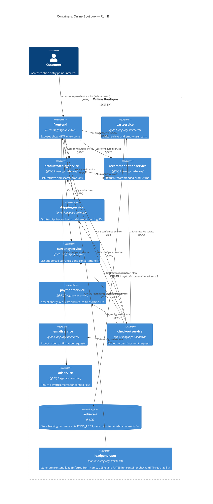

# Agent

Codex, GPT-6.

# Files read

- `AGENTS.md`
- `prompts/1-recover-architecture.md`
- `system/online-boutique/protos/demo.proto`
- `system/online-boutique/kubernetes-manifests/README.md`
- `system/online-boutique/kubernetes-manifests/adservice.yaml`
- `system/online-boutique/kubernetes-manifests/cartservice.yaml`
- `system/online-boutique/kubernetes-manifests/checkoutservice.yaml`
- `system/online-boutique/kubernetes-manifests/currencyservice.yaml`
- `system/online-boutique/kubernetes-manifests/emailservice.yaml`
- `system/online-boutique/kubernetes-manifests/frontend.yaml`
- `system/online-boutique/kubernetes-manifests/kustomization.yaml`
- `system/online-boutique/kubernetes-manifests/loadgenerator.yaml`
- `system/online-boutique/kubernetes-manifests/paymentservice.yaml`
- `system/online-boutique/kubernetes-manifests/productcatalogservice.yaml`
- `system/online-boutique/kubernetes-manifests/recommendationservice.yaml`
- `system/online-boutique/kubernetes-manifests/shippingservice.yaml`

# Containers table

| Name | Technology/language | Responsibility | Evidence |
|---|---|---|---|
| frontend | HTTP server; language Not evidenced in the provided files | Exposes shop HTTP entry point | `system/online-boutique/kubernetes-manifests/frontend.yaml` (frontend-external; ports[name=http]; readinessProbe.httpGet) |
| cartservice | gRPC service; language Not evidenced in the provided files | Add, retrieve and empty user carts | `system/online-boutique/kubernetes-manifests/cartservice.yaml` (Deployment/image; Service ports[name=grpc]); `system/online-boutique/protos/demo.proto` (CartService.AddItem/GetCart/EmptyCart) |
| productcatalogservice | gRPC service; language Not evidenced in the provided files | List, retrieve and search products | `system/online-boutique/kubernetes-manifests/productcatalogservice.yaml` (Deployment/image; Service ports[name=grpc]); `system/online-boutique/protos/demo.proto` (ProductCatalogService.ListProducts/GetProduct/SearchProducts) |
| recommendationservice | gRPC service; language Not evidenced in the provided files | Return recommended product IDs | `system/online-boutique/kubernetes-manifests/recommendationservice.yaml` (Deployment/image; Service ports[name=grpc]); `system/online-boutique/protos/demo.proto` (RecommendationService.ListRecommendations) |
| shippingservice | gRPC service; language Not evidenced in the provided files | Quote shipping and return shipment tracking IDs | `system/online-boutique/kubernetes-manifests/shippingservice.yaml` (Deployment/image; Service ports[name=grpc]); `system/online-boutique/protos/demo.proto` (ShippingService.GetQuote/ShipOrder) |
| currencyservice | gRPC service; language Not evidenced in the provided files | List supported currencies and convert money | `system/online-boutique/kubernetes-manifests/currencyservice.yaml` (Deployment/image; Service ports[name=grpc]); `system/online-boutique/protos/demo.proto` (CurrencyService.GetSupportedCurrencies/Convert) |
| paymentservice | gRPC service; language Not evidenced in the provided files | Accept charge requests and return transaction IDs | `system/online-boutique/kubernetes-manifests/paymentservice.yaml` (Deployment/image; Service ports[name=grpc]); `system/online-boutique/protos/demo.proto` (PaymentService.Charge) |
| emailservice | gRPC service; language Not evidenced in the provided files | Accept order confirmation requests | `system/online-boutique/kubernetes-manifests/emailservice.yaml` (Deployment/image; Service ports[name=grpc]); `system/online-boutique/protos/demo.proto` (EmailService.SendOrderConfirmation) |
| checkoutservice | gRPC service; language Not evidenced in the provided files | Accept order placement requests | `system/online-boutique/kubernetes-manifests/checkoutservice.yaml` (Deployment/image; Service ports[name=grpc]); `system/online-boutique/protos/demo.proto` (CheckoutService.PlaceOrder) |
| adservice | gRPC service; language Not evidenced in the provided files | Return advertisements for context keys | `system/online-boutique/kubernetes-manifests/adservice.yaml` (Deployment/image; Service ports[name=grpc]); `system/online-boutique/protos/demo.proto` (AdService.GetAds) |
| redis-cart | Redis (redis:alpine) | Store backing cartservice via REDIS_ADDR; data mounted at /data on emptyDir | `system/online-boutique/kubernetes-manifests/cartservice.yaml` (redis-cart Deployment; image; volumeMounts; volumes; REDIS_ADDR) |
| loadgenerator | Container image loadgenerator; language Not evidenced in the provided files | Generate frontend load [Inferred from name, USERS and RATE]; init container checks HTTP reachability | `system/online-boutique/kubernetes-manifests/loadgenerator.yaml` (Deployment; FRONTEND_ADDR; USERS; RATE; initContainers.frontend-check) |

Kubernetes Services and ServiceAccounts are deployment infrastructure, not additional C4 containers. `loadgenerator` is included because its Deployment is supplied, but `system/online-boutique/kubernetes-manifests/kustomization.yaml` comments out `loadgenerator.yaml`. Backend languages cannot be derived from image names or the proto `go_package` option.

# Dependencies table

These are configured dependencies, not observed traffic. For each gRPC row, the caller environment variable establishes the destination; the destination manifest’s Service `ports[name=grpc]` and matching service contract in `system/online-boutique/protos/demo.proto` establish the interface. Exact RPC selection and execution order are not evidenced. The human actor is [Inferred] from the exposed shop endpoint.

| Caller → callee | Protocol | Evidence |
|---|---|---|
| frontend → productcatalogservice | gRPC | `system/online-boutique/kubernetes-manifests/frontend.yaml` (PRODUCT_CATALOG_SERVICE_ADDR); `system/online-boutique/kubernetes-manifests/productcatalogservice.yaml` (Service ports[name=grpc]); `system/online-boutique/protos/demo.proto` (matching service contract) |
| frontend → currencyservice | gRPC | `system/online-boutique/kubernetes-manifests/frontend.yaml` (CURRENCY_SERVICE_ADDR); `system/online-boutique/kubernetes-manifests/currencyservice.yaml` (Service ports[name=grpc]); `system/online-boutique/protos/demo.proto` (matching service contract) |
| frontend → cartservice | gRPC | `system/online-boutique/kubernetes-manifests/frontend.yaml` (CART_SERVICE_ADDR); `system/online-boutique/kubernetes-manifests/cartservice.yaml` (Service ports[name=grpc]); `system/online-boutique/protos/demo.proto` (matching service contract) |
| frontend → recommendationservice | gRPC | `system/online-boutique/kubernetes-manifests/frontend.yaml` (RECOMMENDATION_SERVICE_ADDR); `system/online-boutique/kubernetes-manifests/recommendationservice.yaml` (Service ports[name=grpc]); `system/online-boutique/protos/demo.proto` (matching service contract) |
| frontend → shippingservice | gRPC | `system/online-boutique/kubernetes-manifests/frontend.yaml` (SHIPPING_SERVICE_ADDR); `system/online-boutique/kubernetes-manifests/shippingservice.yaml` (Service ports[name=grpc]); `system/online-boutique/protos/demo.proto` (matching service contract) |
| frontend → checkoutservice | gRPC | `system/online-boutique/kubernetes-manifests/frontend.yaml` (CHECKOUT_SERVICE_ADDR); `system/online-boutique/kubernetes-manifests/checkoutservice.yaml` (Service ports[name=grpc]); `system/online-boutique/protos/demo.proto` (matching service contract) |
| frontend → adservice | gRPC | `system/online-boutique/kubernetes-manifests/frontend.yaml` (AD_SERVICE_ADDR); `system/online-boutique/kubernetes-manifests/adservice.yaml` (Service ports[name=grpc]); `system/online-boutique/protos/demo.proto` (matching service contract) |
| checkoutservice → productcatalogservice | gRPC | `system/online-boutique/kubernetes-manifests/checkoutservice.yaml` (PRODUCT_CATALOG_SERVICE_ADDR); `system/online-boutique/kubernetes-manifests/productcatalogservice.yaml` (Service ports[name=grpc]); `system/online-boutique/protos/demo.proto` (matching service contract) |
| checkoutservice → shippingservice | gRPC | `system/online-boutique/kubernetes-manifests/checkoutservice.yaml` (SHIPPING_SERVICE_ADDR); `system/online-boutique/kubernetes-manifests/shippingservice.yaml` (Service ports[name=grpc]); `system/online-boutique/protos/demo.proto` (matching service contract) |
| checkoutservice → paymentservice | gRPC | `system/online-boutique/kubernetes-manifests/checkoutservice.yaml` (PAYMENT_SERVICE_ADDR); `system/online-boutique/kubernetes-manifests/paymentservice.yaml` (Service ports[name=grpc]); `system/online-boutique/protos/demo.proto` (matching service contract) |
| checkoutservice → emailservice | gRPC | `system/online-boutique/kubernetes-manifests/checkoutservice.yaml` (EMAIL_SERVICE_ADDR); `system/online-boutique/kubernetes-manifests/emailservice.yaml` (Service ports[name=grpc]); `system/online-boutique/protos/demo.proto` (matching service contract) |
| checkoutservice → currencyservice | gRPC | `system/online-boutique/kubernetes-manifests/checkoutservice.yaml` (CURRENCY_SERVICE_ADDR); `system/online-boutique/kubernetes-manifests/currencyservice.yaml` (Service ports[name=grpc]); `system/online-boutique/protos/demo.proto` (matching service contract) |
| checkoutservice → cartservice | gRPC | `system/online-boutique/kubernetes-manifests/checkoutservice.yaml` (CART_SERVICE_ADDR); `system/online-boutique/kubernetes-manifests/cartservice.yaml` (Service ports[name=grpc]); `system/online-boutique/protos/demo.proto` (matching service contract) |
| recommendationservice → productcatalogservice | gRPC | `system/online-boutique/kubernetes-manifests/recommendationservice.yaml` (PRODUCT_CATALOG_SERVICE_ADDR); `system/online-boutique/kubernetes-manifests/productcatalogservice.yaml` (Service ports[name=grpc]); `system/online-boutique/protos/demo.proto` (matching service contract) |
| cartservice → redis-cart | TCP :6379; application protocol not evidenced | `system/online-boutique/kubernetes-manifests/cartservice.yaml` (REDIS_ADDR=redis-cart:6379; Service ports[name=tcp-redis]) |
| loadgenerator → frontend | HTTP | `system/online-boutique/kubernetes-manifests/loadgenerator.yaml` (FRONTEND_ADDR=frontend:80; initContainers.frontend-check command http://${FRONTEND_ADDR}) |
| customer → frontend | HTTP | `system/online-boutique/kubernetes-manifests/frontend.yaml` (frontend-external; type=LoadBalancer; ports[name=http] 80 → 8080) |

# Mermaid diagram

# Gaps

| Gap | Evidence limit | Extra file that would settle it (not read) |
|---|---|---|
| Implementation languages and libraries | Not evidenced in the provided files. Kubernetes images are unqualified service names; proto language options do not establish server implementations. | Each service’s `system/online-boutique/src/<service>/Dockerfile` and application entry point. |
| Shopping assistant container and active calls | `system/online-boutique/kubernetes-manifests/frontend.yaml` sets `SHOPPING_ASSISTANT_SERVICE_ADDR=shoppingassistantservice:80`, but `ENABLE_ASSISTANT` is commented out; no matching Deployment, Service or proto contract appears in the supplied files. Runtime use, technology and protocol: Not evidenced in the provided files. Omitted from both tables and diagram. | `system/online-boutique/kustomize/components/shopping-assistant/kustomization.yaml` and frontend assistant call implementation. |
| Actual RPC calls, ordering, retries and failure handling | Not evidenced in the provided files. Environment variables show configured targets; contracts show available operations. | Caller implementations under `system/online-boutique/src/frontend/`, `checkoutservice/` and `recommendationservice/`. |
| Redis application protocol, data model and durability settings | `system/online-boutique/kubernetes-manifests/cartservice.yaml` shows TCP 6379, `redis:alpine`, and `/data` backed by `emptyDir`; client commands and Redis persistence configuration are Not evidenced in the provided files. | Cart storage implementation under `system/online-boutique/src/cartservice/` and Redis runtime configuration. |
| Product storage, external payment/email/shipping providers, message brokers and telemetry destinations | Not evidenced in the provided files. RPC names alone do not prove external integrations. No such additional container or dependency is added. | Relevant service implementations and their runtime configuration. |
| User journeys, HTTPS and load generation behavior | External frontend HTTP port is evidenced; human use is [Inferred]. HTTPS termination and loadgenerator request mix are Not evidenced in the provided files. | Frontend routes/templates, ingress/TLS configuration, and `system/online-boutique/src/loadgenerator/locustfile.py`. |
| Final deployed topology and image versions | `system/online-boutique/kubernetes-manifests/README.md` says these manifests require Skaffold image substitution; base Kustomization excludes loadgenerator. Actual deployment is Not evidenced in the provided files. | `system/online-boutique/skaffold.yaml` and deployed/rendered manifests. |
